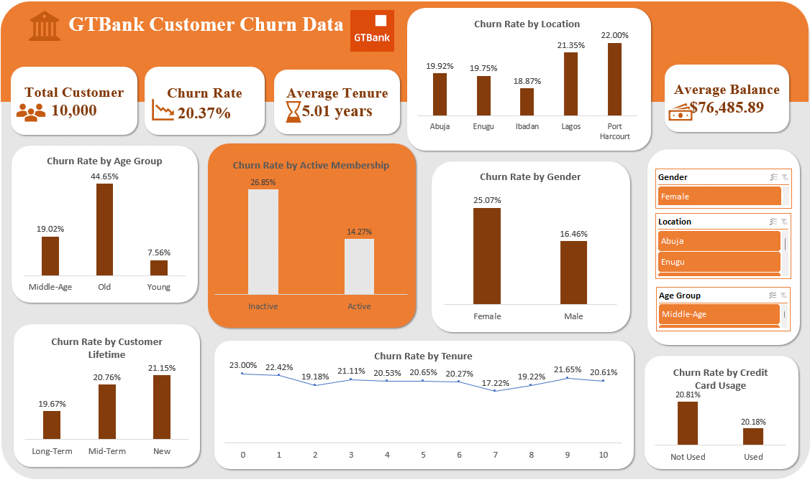

# GTBank-Data-Analysis (Interactive Dashboard Creation Using MS Excel)
## Project Overview
This repository contains my data analysis projects completed using Microsoft Excel. The projects focus on transforming raw data into meaningful insights through data preprocessing, data cleaning, exploratory data analysis, Pivot Tables, and data visualization.
## Dataset Used
- <a href="https://github.com/davidowurre/Excel-Data-Analysis-Project/blob/main/Customer%20Churn%20(GT%20Bank).xlsx">Dataset</a>

## Tools & Skills Used
-Microsoft Excel
-Data Cleaning and Preprocessing
-Pivot Tables and Pivot Charts
-Data Analysis
-Data Visualization

## Dashboad

